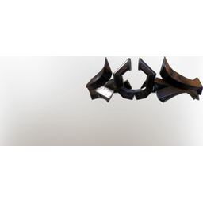

# T6 Magic Lightning Helmet - Unique

| | |
|---|---|
| Category | [Armor & Equipment](../../categories/equipment.md) |
| Rarity | 🟠 Legendary |
| Level | 40 |
| Max stack | 1 |
| Item ID | `2952703997` |
| Internal name | `Armor_T6_Unique_Magic_Lightning_Helmet` |

## Description

t6 Magic_Lightning helmet desc - unique

## Stats

| | |
|---|---|
| Slot | Head |
| Armor | Physical and Magical |
| Mana | 54 |
| Mana Regeneration | 18 |
| Increased Lightning Damage | 5 |
| Critical Strike Chance Vs Soaked Enemies | 21 |

## Enhancements

Unlocked one after another as the item is upgraded, in this order. Armor and damage bonuses grow with the item level, so their numbers are shown in game only.

| | Enhancement | Effect |
|:---:|---|---|
| 1 | Piercing Armor | - |
| 2 | +1 Spellslinger | Increases the skill level of Spellslinger by +1 |
| 3 | +1 Terror | Increases the skill level of Terror by +1 |
| 4 | +1 Spellslinger | Increases the skill level of Spellslinger by +1 |
| 5 | +1 Thunder | Increases the skill level of Thunder by +1 |

---

[← Armor & Equipment](../../categories/equipment.md) · [All categories](../../README.md)
