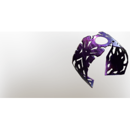

# Ward T5

| | |
|---|---|
| Category | [Armor & Equipment](../../categories/equipment.md) |
| Rarity | 🔵 Rare |
| Level | 30 |
| Max stack | 1 |
| Item ID | `2394759659` |
| Internal name | `Ward_T5` |

One of 2 versions of this item: see [Ward T5](../../objects/equipment/ward-t5.md) for all of them and how they differ.

## Description

ward t5 desc

## Stats

| | |
|---|---|
| Slot | Shield |
| Parry Power | 1 |
| Mana Regeneration | 6 |
| Fog Resistance | 5 |

## Enhancements

Unlocked one after another as the item is upgraded, in this order. Armor and damage bonuses grow with the item level, so their numbers are shown in game only.

| | Enhancement | Effect |
|:---:|---|---|
| 1 | +1 Eternal Spark | Increases the skill level of Eternal Spark by +1 |
| 2 | +1 Shroud Resistance | Increases the skill level of Shroud Resistance by +1 |
| 3 | +1 Arcane Deflection | Increases the skill level of Arcane Deflection by +1 |
| 4 | +1 Unity | Increases the skill level of Unity by +1 |
| 5 | +1 Wand Mastery | Increases the skill level of Wand Mastery by +1 |

## How to get it

- **Alchemist**: 2 × T5 Silver Bar, 1 × T5 Material Amethyst, 2 × [Shroud Vapor](../../items/materials/shroud-vapor-579568751.md), 1 × [Evil Cyclops Eye](../../items/materials/evil-cyclops-eye-2861211892.md) → 1 ×

---

[← Armor & Equipment](../../categories/equipment.md) · [All categories](../../README.md) · [JSON](ward-t5-2394759659.json)
