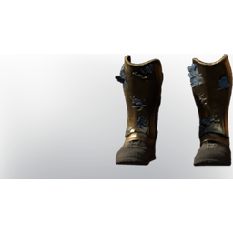

# Warrior Fog Protection Armor

| | |
|---|---|
| Category | [Armor & Equipment](../../categories/equipment.md) |
| Rarity | 🔵 Rare |
| Level | 15 |
| Max stack | 1 |
| Item ID | `875044567` |
| Internal name | `Armor_T3_Warrior_FogProtection_Boots` |

One of 5 versions of this item: see [Warrior Fog Protection Armor](../../objects/equipment/warrior-fog-protection-armor.md) for all of them and how they differ.

## Description

Hastely put together from fell monster parts. Offers extended protection against the Shroud.

## Stats

| | |
|---|---|
| Slot | Feet |
| Armor | Physical and Magical |
| Health Regeneration | 9 |
| Fog Resistance | 5 |

## Enhancements

Unlocked one after another as the item is upgraded, in this order. Armor and damage bonuses grow with the item level, so their numbers are shown in game only.

| | Enhancement | Effect |
|:---:|---|---|
| 1 | Cutting Armor | - |
| 2 | +1 Warrior's Path | Increases the skill level of Warrior's Path by +1 |
| 3 | +1 Earth Aura | Increases the skill level of Earth Aura by +1 |

## How to get it

- **Blacksmith**: 4 × [Fossilized Bone](../../items/materials/fossilized-bone-3095665634.md), 1 × [Bronze Bars](../../items/materials/bronze-bars-642002617.md), 4 × [Shroud Adhesive](../../items/materials/shroud-adhesive-1047122195.md), 2 × [Corrosive Blood](../../items/materials/corrosive-blood-2302389683.md) → 1 ×

---

[← Armor & Equipment](../../categories/equipment.md) · [All categories](../../README.md) · [JSON](warrior-fog-protection-armor-875044567.json)
