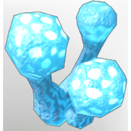

# ActiveMycelium

| | |
|---|---|
| Category | [Materials](../../categories/materials.md) |
| Rarity | ⚪ Common |
| Level | 5 |
| Max stack | 250 |
| Item ID | `2179075323` |
| Internal name | `Material_T1_FogTerrain_ActiveMycelium` |

## Description

Active Mycelium of fog mushrooms, absorbing the magical properties of the fog in the air. Could this be used for alchemical purposes?

## Where to find

Springlands Shroud

## Used to make

[Flask of the Fallen](../../items/consumables/flask-of-the-fallen-2635793540.md), [Fog Survival Flask](../../items/consumables/fog-survival-flask-1782997504.md), [Ancient Health Potion](../../items/consumables/ancient-health-potion-1756446918.md), [T7 Eternal Shroud Beam Channel](../../items/ammunition/t7-eternal-shroud-beam-channel-803538053.md), [Shroud Arrow III](../../items/ammunition/shroud-arrow-iii-3333535459.md), [Shroud Vapor](../../items/materials/shroud-vapor-579568751.md), [Alchemist Apprentice Chest](../../items/equipment/alchemist-apprentice-chest-3440719310.md), [Rising Fighter Chest](../../items/equipment/rising-fighter-chest-2937561739.md), [Scout Chest](../../items/equipment/scout-chest-4113785177.md), [Vorgoth's Pants](../../items/equipment/vorgoth-s-pants-3057524028.md)

---

[← Materials](../../categories/materials.md) · [All categories](../../README.md)
