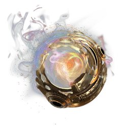

# Ancient/Archaic Infusion

| | |
|---|---|
| Category | [Materials](../../categories/materials.md) |
| Rarity | ⚪ Common |
| Level | 45 |
| Max stack | 250 |
| Item ID | `2670118573` |
| Internal name | `Material_T7_Ancient_Infusion` |

## Description

this ancient infusion is created from exclusive ancient materials and holds extraterrestrial abilities(?) the ancient researcher npc can use it and create magical things with it for you.

## Where to find

Magic Infusion Station

---

[← Materials](../../categories/materials.md) · [All categories](../../README.md)
