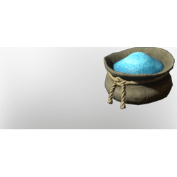

# Aquamarine Dust

| | |
|---|---|
| Category | [Materials](../../categories/materials.md) |
| Rarity | ⚪ Common |
| Level | 40 |
| Max stack | 250 |
| Item ID | `554104227` |
| Internal name | `Material_T6_Aquamarine_Dust` |

## Description

t6 Aquamarine dust desc

## Where to find

Crafting, Improved Grinder

## How to get it

- **improved grinder; water wheel grinder)**: 1 × Aquamarine → 1 ×

## Used to make

[Ultimate Health Potion](../../items/consumables/ultimate-health-potion-491393994.md), [T6 Eternal Mana Leech Beam VII](../../items/ammunition/t6-eternal-mana-leech-beam-vii-2404490725.md), [Eternal Shock Arrow II](../../items/ammunition/eternal-shock-arrow-ii-2453015274.md), [T6 Pillar of Flames III](../../items/ammunition/t6-pillar-of-flames-iii-111980330.md), [T6 Ice Totem II](../../items/ammunition/t6-ice-totem-ii-3960177886.md), [Pretty In Pink](../../items/colorpalette/pretty-in-pink-220072414.md), [Fell Fashion](../../items/colorpalette/fell-fashion-855563189.md), [Veil Of Blues](../../items/colorpalette/veil-of-blues-391330740.md), [Pikemead's Ward](../../items/equipment/pikemead-s-ward-3957855784.md), [T6 Shield Tank](../../items/equipment/t6-shield-tank-1777113935.md), [T6 Shield DPS](../../items/equipment/t6-shield-dps-2863750697.md), [Lord Vorgoth's Sword](../../items/weapons/lord-vorgoth-s-sword-4073230411.md), [Darya's Wand](../../items/weapons/darya-s-wand-1561187159.md), [Blue Pendant Light I](../../items/buildtools/blue-pendant-light-i-2309442083.md), [Blue Pendant Light II](../../items/buildtools/blue-pendant-light-ii-939235192.md), [Blue Wall Light I](../../items/buildtools/blue-wall-light-i-14979379.md), [Blue Wall Light II](../../items/buildtools/blue-wall-light-ii-3687127031.md), [Blue Floor Light I](../../items/buildtools/blue-floor-light-i-1747355696.md), [Blue Floor Light II](../../items/buildtools/blue-floor-light-ii-2925532764.md), [Skull Trophy I](../../items/buildtools/skull-trophy-i-970794453.md)

---

[← Materials](../../categories/materials.md) · [All categories](../../README.md)
