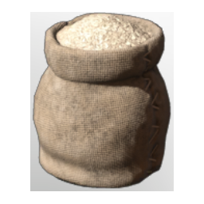

# Bonemeal

| | |
|---|---|
| Category | [Materials](../../categories/materials.md) |
| Rarity | ⚪ Common |
| Level | 5 |
| Max stack | 250 |
| Item ID | `2982735558` |
| Internal name | `Material_T1_Bonemeal` |

## Description

Pounded bones - useful for alchemical and magical purposes.

## Where to find

Crafting, Hand Grinder

## How to get it

- **Grinding Stones**: 2 × [Bones](../../items/materials/bones-2053375978.md) → 3 ×

## Used to make

[Ice Protection Lotion](../../items/consumables/ice-protection-lotion-386738695.md), [T1 Fireball I](../../items/ammunition/t1-fireball-i-3918049792.md), [T1 Heal Channel I](../../items/ammunition/t1-heal-channel-i-1899806950.md), [T2 Chain Heal I](../../items/ammunition/t2-chain-heal-i-3878494540.md), [T2 Chain Lightning I](../../items/ammunition/t2-chain-lightning-i-1048548069.md), [T3 Ball Lightning](../../items/ammunition/t3-ball-lightning-1735403844.md), [T3 Shock Totem I](../../items/ammunition/t3-shock-totem-i-4044132453.md), [Skull Summoning Vessel](../../items/weapons/skull-summoning-vessel-1596935538.md), [Skull companion Level 20](../../items/weapons/skull-companion-level-20-305542871.md), [Skull companion Level 15](../../items/weapons/skull-companion-level-15-1105258830.md), [Skull Companion](../../items/weapons/skull-companion-3124613974.md), [Penny Bun Seedling](../../items/buildtools/penny-bun-seedling-751481953.md), [Sage Seedling](../../items/buildtools/sage-seedling-4018682338.md), [St Johns Worth Seedling](../../items/buildtools/st-johns-worth-seedling-2762446918.md), [T5 Palette 03 Pink and Grey](../../items/colorpalette/t5-palette-03-pink-and-grey-468594079.md), [T1 Palette 03 Brown dark grey](../../items/colorpalette/t1-palette-03-brown-dark-grey-103217131.md), [T1 Palette 02 Grey Brown](../../items/colorpalette/t1-palette-02-grey-brown-51104213.md), [Krypt Krystal](../../items/materials/krypt-krystal-3953523416.md), [Tbd T1 Palette 01 Reward A Fancy Outlook](../../items/colorpalette/tbd-t1-palette-01-reward-a-fancy-outlook-968828649.md), [Glow Dirt WarmWhite](../../items/materials/glow-dirt-warmwhite-3962501836.md), [T1 lore wand](../../items/weapons/t1-lore-wand-2195022120.md), [Spiritual Cane](../../items/weapons/spiritual-cane-3536356032.md), [Spectral Shield](../../items/equipment/spectral-shield-201987856.md), [Alchemist Apprentice Trousers](../../items/equipment/alchemist-apprentice-trousers-2554999858.md), [Alchemist Apprentice Gloves](../../items/equipment/alchemist-apprentice-gloves-3303276493.md), [Alchemist Apprentice Chest](../../items/equipment/alchemist-apprentice-chest-3440719310.md), [Alchemist Apprentice Hat](../../items/equipment/alchemist-apprentice-hat-1572355779.md), [Cauldron](../../items/buildtools/cauldron-311508484.md), [Farm Soil](../../items/materials/farm-soil-1823674426.md)

---

[← Materials](../../categories/materials.md) · [All categories](../../README.md)
