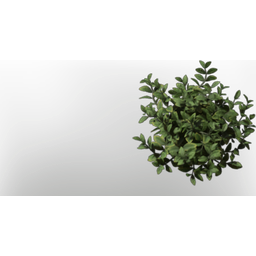

# Boxwood Material

| | |
|---|---|
| Category | [Materials](../../categories/materials.md) |
| Rarity | ⚪ Common |
| Level | - |
| Max stack | 250 |
| Item ID | `2297010177` |
| Internal name | `Build_TerrainMaterial_T2_TallTree_BoxTree` |

## Description

A leafy green plant material, naturally occuring in the Blackmire. Can be used for hedgemazes or garden artistry.

## Where to find

Blackmire

---

[← Materials](../../categories/materials.md) · [All categories](../../README.md)
