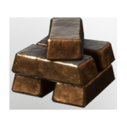

# Bronze Bars

| | |
|---|---|
| Category | [Materials](../../categories/materials.md) |
| Rarity | ⚪ Common |
| Level | 18 |
| Max stack | 250 |
| Item ID | `642002617` |
| Internal name | `Material_T3_Bronze_Bar` |

## Description

A beautiful material known for its warm and bright colour. Artisans around the world have turned towards it for centuries, due to its workable characteristics.

## Where to find

Smelter

## How to get it

- **Blast Furnace**: 10 × [Copper Bar](../../items/materials/copper-bar-170689373.md), 4 × [Tin Bars](../../items/materials/tin-bars-1072522988.md), 10 × T5 Material Coal Name → 20 ×
- **Smelter**: 7 × [Copper Bar](../../items/materials/copper-bar-170689373.md), 3 × [Tin Bars](../../items/materials/tin-bars-1072522988.md), 10 × [Charcoal](../../items/materials/charcoal-372029138.md) → 10 ×

## Used to make

[Decay Tool](../../items/blueprints/decay-tool-3286071567.md), [Large Chest](../../items/buildtools/large-chest-4204849649.md), [Magic Large Chest](../../items/buildtools/magic-large-chest-3681207826.md), [Channelled Water Tool](../../items/buildtools/channelled-water-tool-1053852637.md), [Cursed Fishing Rod](../../items/buildtools/cursed-fishing-rod-1815671523.md), [Moonshine and Stars Block](../../items/buildtools/moonshine-and-stars-block-688801496.md), [HallowHalls Decorative Dungeon Block](../../items/buildtools/hallowhalls-decorative-dungeon-block-2848160320.md), [Bronze Block](../../items/buildtools/bronze-block-53541119.md), [T4 Desert Shingles](../../items/buildtools/t4-desert-shingles-3899129081.md), [Bronze Arrow](../../items/ammunition/bronze-arrow-3990911183.md), [T3 Eternal Fireball I](../../items/ammunition/t3-eternal-fireball-i-1912744772.md), [T3 Fire Totem](../../items/ammunition/t3-fire-totem-2830104367.md), [Improved Water Well](../../items/buildtools/improved-water-well-1155756187.md), [Spinning Wheel](../../items/buildtools/spinning-wheel-720550594.md), [Loom](../../items/buildtools/loom-48453107.md), [Bronze Axe](../../items/tools/bronze-axe-1012249632.md), [Bronze Pickaxe](../../items/buildtools/bronze-pickaxe-2410457699.md), [Fenrig's Axe](../../items/weapons/fenrig-s-axe-3530269879.md), [Jezmina's Apotheosis](../../items/weapons/jezmina-s-apotheosis-2628423562.md), [Lupa's scalper](../../items/weapons/lupa-s-scalper-2387592374.md), [Wolf's Hydra](../../items/weapons/wolf-s-hydra-4103969369.md), [Halescourge](../../items/weapons/halescourge-602591868.md), [Wailing Blade](../../items/weapons/wailing-blade-4253086109.md), [Dragon Sword](../../items/weapons/dragon-sword-3907468980.md), [Shield of Light](../../items/equipment/shield-of-light-2584194594.md), [Pikemead's Ward](../../items/equipment/pikemead-s-ward-1237193461.md), [Riptide](../../items/equipment/riptide-870935206.md), [Ancestral Star](../../items/weapons/ancestral-star-430276931.md), [Golden Recruit Axe](../../items/weapons/golden-recruit-axe-2176171412.md), [Golden War Veteran Axe](../../items/weapons/golden-war-veteran-axe-1877646424.md), [Soothsayer](../../items/weapons/soothsayer-1716859550.md), [Consumed fog soldier bow](../../items/weapons/consumed-fog-soldier-bow-2517864696.md), [Throwing Knives](../../items/weapons/throwing-knives-4131716794.md), [Sacrificial Vukah Dagger](../../items/weapons/sacrificial-vukah-dagger-1072446832.md), [Valor Heart Dagger](../../items/weapons/valor-heart-dagger-2837156111.md), [Darya's Wand](../../items/weapons/darya-s-wand-2104873327.md), [Darya's Staff](../../items/weapons/darya-s-staff-4000975642.md), [Transcendental Screen](../../items/equipment/transcendental-screen-2821143924.md), [T3 DPS Boots](../../items/equipment/t3-dps-boots-30416182.md), [T3 DPS Legs](../../items/equipment/t3-dps-legs-2034875163.md) and 61 more

---

[← Materials](../../categories/materials.md) · [All categories](../../README.md)
