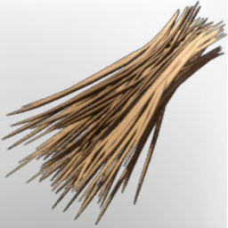

# Capybara Bristles

| | |
|---|---|
| Category | [Materials](../../categories/materials.md) |
| Rarity | ⚪ Common |
| Level | 40 |
| Max stack | 250 |
| Item ID | `4230368891` |
| Internal name | `Material_T6_CapybaraBristles` |

## Description

t6 Capybara Bristles desc

## Where to find

Veilwater Basin

## Used to make

[Epic Fishing Bait I](../../items/ammunition/epic-fishing-bait-i-471470231.md), [Rare Bait](../../items/ammunition/rare-bait-1313427371.md), [Uncommon Bait](../../items/ammunition/uncommon-bait-2520666169.md), [Common Bait](../../items/ammunition/common-bait-1246545941.md), [Miner Helmet](../../items/equipment/miner-helmet-1392674456.md), [T6 Assassin Legs](../../items/equipment/t6-assassin-legs-2230173783.md)

---

[← Materials](../../categories/materials.md) · [All categories](../../README.md)
