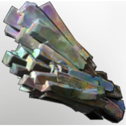

# Celesthium Ore

| | |
|---|---|
| Category | [Materials](../../categories/materials.md) |
| Rarity | ⚪ Common |
| Level | 45 |
| Max stack | 250 |
| Item ID | `2035945146` |
| Internal name | `Material_T7_Celesthium_Ore` |

## Description

celesthium ore desc

## Where to find

Ancient Land

## Used to make

[Ancient Enegry Block](../../items/buildtools/ancient-enegry-block-2130648477.md), [Sparkling Dust](../../items/materials/sparkling-dust-844454296.md), [Celesthium Bars](../../items/materials/celesthium-bars-2893592883.md)

---

[← Materials](../../categories/materials.md) · [All categories](../../README.md) · [JSON](celesthium-ore-2035945146.json)
