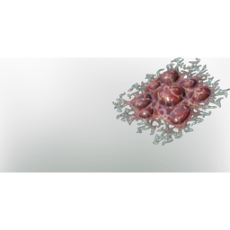

# Corrosive Blood

| | |
|---|---|
| Category | [Materials](../../categories/materials.md) |
| Rarity | 🟢 Uncommon |
| Level | 18 |
| Max stack | 250 |
| Item ID | `2302389683` |
| Internal name | `Material_T3_CorrosiveBlood` |

## Description

A volatile, acidic fluid harvested from weak Fell Foes. Its corrosive properties make it a valuable ingredient in crafting repair kits, where its unique chemistry is harnessed to restore the durability of worn-out items.

## Where to find

Fell Enemies, First: Nomad Highlands Shroud

## Used to make

[Repair Kit](../../items/consumables/repair-kit-3377002158.md), [T4 Palette 03 maroon](../../items/colorpalette/t4-palette-03-maroon-3687407983.md), [Tbd T4 Palette 01 Reward Red,Orange, Yellow](../../items/colorpalette/tbd-t4-palette-01-reward-red-orange-yellow-1316536777.md), [Alchemical Base](../../items/materials/alchemical-base-2371777842.md), [T3 DPS Arms](../../items/equipment/t3-dps-arms-2202659557.md), [T3 Mage Chest](../../items/equipment/t3-mage-chest-1523324827.md), [Mage Fog Protection Armor](../../items/equipment/mage-fog-protection-armor-1559741302.md), [T3 Ranger Chest](../../items/equipment/t3-ranger-chest-2255840984.md), [Ranger Fog Protection Armor](../../items/equipment/ranger-fog-protection-armor-13759280.md), [T3 Archer Arms](../../items/equipment/t3-archer-arms-699269342.md), [T3 Tank Boots](../../items/equipment/t3-tank-boots-536100641.md), [Warrior Fog Protection Armor](../../items/equipment/warrior-fog-protection-armor-875044567.md)

---

[← Materials](../../categories/materials.md) · [All categories](../../README.md) · [JSON](corrosive-blood-2302389683.json)
