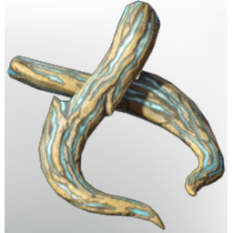

# Corrupted Boar Tusk

| | |
|---|---|
| Category | [Materials](../../categories/materials.md) |
| Rarity | 🟢 Uncommon |
| Level | 13 |
| Max stack | 250 |
| Item ID | `3405461465` |
| Internal name | `Material_T2_CorruptedBoarTusk` |

## Description

A jagged tusk blackened by Shroud corruption. Pulsing with faint traces of toxic energy, it carries the raw aggression of the Shroud Boar it came from. A prized material for crafting brutal weapons or armor enhancements

## Where to find

Fell Boars, Revelwood Shroud

## Used to make

[T6 Eternal Fireball II](../../items/ammunition/t6-eternal-fireball-ii-1334157650.md), [T2 Ice Bolt II](../../items/ammunition/t2-ice-bolt-ii-2728050036.md), [T2 Healer Legs](../../items/equipment/t2-healer-legs-722422442.md), [T2 Mage Legs](../../items/equipment/t2-mage-legs-1798843751.md), [T2 Ranger Legs](../../items/equipment/t2-ranger-legs-2374868988.md), [T2 Archer Legs](../../items/equipment/t2-archer-legs-3559413170.md), [T2 Tank Legs](../../items/equipment/t2-tank-legs-2509853978.md)

---

[← Materials](../../categories/materials.md) · [All categories](../../README.md) · [JSON](corrupted-boar-tusk-3405461465.json)
