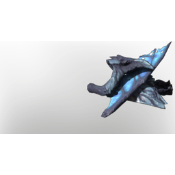

# Critter Parts

| | |
|---|---|
| Category | [Materials](../../categories/materials.md) |
| Rarity | ⚪ Common |
| Level | 5 |
| Max stack | 250 |
| Item ID | `3264892278` |
| Internal name | `Material_T1_CritterParts` |

## Description

Remains of the pests that dwell below the fog. These parts should be rich with fog substances.

## Where to find

Springlands and Revelwood Fell Enemies

---

[← Materials](../../categories/materials.md) · [All categories](../../README.md)
