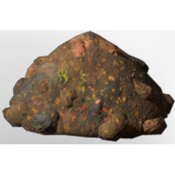

# Deep Forest Dirt

| | |
|---|---|
| Category | [Materials](../../categories/materials.md) |
| Rarity | ⚪ Common |
| Level | - |
| Max stack | 1000 |
| Item ID | `3937186197` |
| Internal name | `Build_TerrainMaterial_T2_Dirt_DeepForest` |

## Description

A mix of all kinds of materials. Not very useful, but so are many byproducts.

## Used to make

[City Wall Stone Block](../../items/buildtools/city-wall-stone-block-1956408861.md), [T2 Palette 02 shades of grey](../../items/colorpalette/t2-palette-02-shades-of-grey-556297753.md), [T2 Palette 01 Brown bright Grey](../../items/colorpalette/t2-palette-01-brown-bright-grey-4016272699.md), [Climbing Rose overgrowth plant](../../items/buildtools/climbing-rose-overgrowth-plant-779558916.md), [Fertile Deepforest Dirt](../../items/materials/fertile-deepforest-dirt-459345780.md), [Deepforest Rubble](../../items/materials/deepforest-rubble-1619282664.md)

---

[← Materials](../../categories/materials.md) · [All categories](../../README.md)
