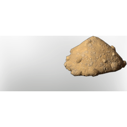

# Dirt

| | |
|---|---|
| Category | [Materials](../../categories/materials.md) |
| Rarity | ⚪ Common |
| Level | - |
| Max stack | 1000 |
| Item ID | `1558115984` |
| Internal name | `Build_TerrainMaterial_T1_Dirt_Grassland` |

## Description

A mix of all kinds of materials. Not very useful, but so are many byproducts.

## Used to make

[Limestone Block](../../items/buildtools/limestone-block-2365603799.md), [Field Stones](../../items/materials/field-stones-2992740264.md), [Road Dirt](../../items/materials/road-dirt-447697249.md), [Road Stone 1](../../items/materials/road-stone-1-323499580.md), [T3 Acid Cone](../../items/ammunition/t3-acid-cone-471823515.md), [T1 Palette 01 Brown Grey](../../items/colorpalette/t1-palette-01-brown-grey-1639517943.md), [T1 Palette 04 Brown blue grey](../../items/colorpalette/t1-palette-04-brown-blue-grey-2299237068.md), [T1 Palette 03 Brown dark grey](../../items/colorpalette/t1-palette-03-brown-dark-grey-103217131.md), [Goo](../../items/materials/goo-3403995938.md), [Tbd T1 Palette 01 Reward A Fancy Outlook](../../items/colorpalette/tbd-t1-palette-01-reward-a-fancy-outlook-968828649.md), [Glow Dirt WarmWhite](../../items/materials/glow-dirt-warmwhite-3962501836.md), [Crucible](../../items/buildtools/crucible-4111981896.md), [Farm Soil](../../items/materials/farm-soil-1823674426.md), [Fertile Grassland Dirt](../../items/materials/fertile-grassland-dirt-2517406505.md), [Grassland Rubble](../../items/materials/grassland-rubble-4233423640.md)

---

[← Materials](../../categories/materials.md) · [All categories](../../README.md) · [JSON](dirt-1558115984.json)
