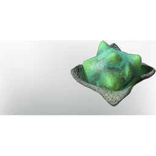

# Extraordinary Ectoplasm

| | |
|---|---|
| Category | [Materials](../../categories/materials.md) |
| Rarity | 🟢 Uncommon |
| Level | 40 |
| Max stack | 250 |
| Item ID | `1506592036` |
| Internal name | `Material_T6_SlurpBroth` |

## Description

t6 slurp broth desc

## Where to find

Crafting, Ectoplasm Press

## How to get it

- **skullCrockPot**: 10 × [T6 Green Essence (Ectoplasm Aggregate??)](../../items/materials/t6-green-essence-ectoplasm-aggregate-4005698976.md), 10 × [Torn Cloth](../../items/materials/torn-cloth-1496290527.md), 1 × [Fabric](../../items/materials/fabric-2128518559.md), 15 × [Mother-Of-Pearl](../../items/materials/mother-of-pearl-1898288525.md) → 10 ×

## Used to make

[Extraordinary Ectoplasm Soup](../../items/consumables/extraordinary-ectoplasm-soup-3329610289.md)

---

[← Materials](../../categories/materials.md) · [All categories](../../README.md)
