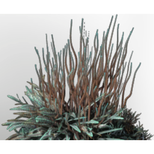

# Fertile AncientLand T7 Dirt For Special Ancient Grass

| | |
|---|---|
| Category | [Materials](../../categories/materials.md) |
| Rarity | ⚪ Common |
| Level | - |
| Max stack | 1000 |
| Item ID | `1458330217` |
| Internal name | `Build_TerrainMaterial_T7_AncientLand_fertile_Ancientgrass` |

## Description

A mix of all kinds of materials. Not very useful, but so are many byproducts.

## How to get it

- **Workbench**: 1 × T7 material stone, 1 × [T7 material Ancient Land granite stone](../../items/materials/t7-material-ancient-land-granite-stone-2851443310.md), 8 × [T7 AncientLand Dirt](../../items/materials/t7-ancientland-dirt-2421105715.md) → 10 ×

---

[← Materials](../../categories/materials.md) · [All categories](../../README.md) · [JSON](fertile-ancientland-t7-dirt-for-special-ancient-grass-1458330217.json)
