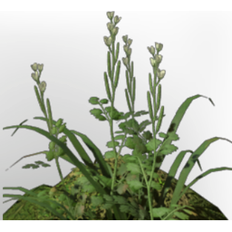

# Fertile Deepforest Dirt

| | |
|---|---|
| Category | [Materials](../../categories/materials.md) |
| Rarity | ⚪ Common |
| Level | - |
| Max stack | 1000 |
| Item ID | `459345780` |
| Internal name | `Build_TerrainMaterial_T2_Deepforest_fertile_Highgrass` |

## Description

A mix of all kinds of materials. Not very useful, but so are many byproducts.

## How to get it

- **Workbench**: 1 × [Farm Soil](../../items/materials/farm-soil-1823674426.md), 9 × [Deep Forest Dirt](../../items/materials/deep-forest-dirt-3937186197.md) → 10 ×

---

[← Materials](../../categories/materials.md) · [All categories](../../README.md)
