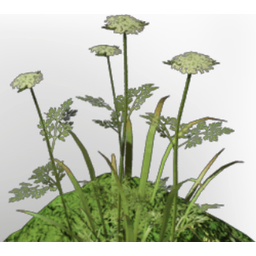

# Fertile Grassland Dirt

| | |
|---|---|
| Category | [Materials](../../categories/materials.md) |
| Rarity | ⚪ Common |
| Level | - |
| Max stack | 1000 |
| Item ID | `2517406505` |
| Internal name | `Build_TerrainMaterial_T1_Grassland_fertile_Highgrass` |

## Description

A mix of all kinds of materials. Not very useful, but so are many byproducts.

## How to get it

- **Workbench**: 1 × [Farm Soil](../../items/materials/farm-soil-1823674426.md), 9 × [Dirt](../../items/materials/dirt-1558115984.md) → 10 ×

---

[← Materials](../../categories/materials.md) · [All categories](../../README.md)
