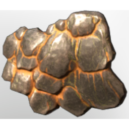

# Fish Scales

| | |
|---|---|
| Category | [Materials](../../categories/materials.md) |
| Rarity | ⚪ Common |
| Level | 45 |
| Max stack | 250 |
| Item ID | `4040557403` |
| Internal name | `Material_T7_Fish_Scales` |

## Description

The scales are still warm when removed from the fish. They never fully cool and are popular under fire mages for obvious reasons.

## Where to find

Fisher

## How to get it

- **Fish Trader**: 1 × [Specklefin](../../items/consumables/specklefin-4122706847.md), 2 × [T6 Material Gold Coins](../../items/materials/t6-material-gold-coins-2572858337.md) → 1 ×

## Used to make

[T7 Eternal Fireball III](../../items/ammunition/t7-eternal-fireball-iii-3838422264.md), [T7 Eternal Fire Totem II](../../items/ammunition/t7-eternal-fire-totem-ii-3916550351.md), [T7 Eternal Entangle](../../items/ammunition/t7-eternal-entangle-967466975.md), [Epic Fishing Bait II](../../items/ammunition/epic-fishing-bait-ii-3765704048.md), [Riptide](../../items/equipment/riptide-349263893.md), [Cryptic wand](../../items/weapons/cryptic-wand-2053280664.md)

---

[← Materials](../../categories/materials.md) · [All categories](../../README.md)
