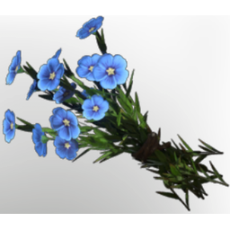

# Flax

| | |
|---|---|
| Category | [Materials](../../categories/materials.md) |
| Rarity | ⚪ Common |
| Level | 13 |
| Max stack | 250 |
| Item ID | `3898847112` |
| Internal name | `Material_T2_Flax` |

## Description

A popular plant due to its strong fibers. It can be used to make linnen.

## Where to find

Revelwood

## Used to make

[Flax Seedling](../../items/buildtools/flax-seedling-34487402.md), [Linnen](../../items/materials/linnen-1815424180.md), [Climbing Rose overgrowth plant](../../items/buildtools/climbing-rose-overgrowth-plant-779558916.md)

---

[← Materials](../../categories/materials.md) · [All categories](../../README.md)
