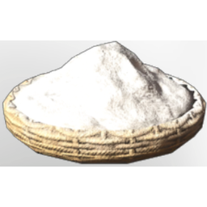

# Flour

| | |
|---|---|
| Category | [Materials](../../categories/materials.md) |
| Rarity | ⚪ Common |
| Level | 18 |
| Max stack | 250 |
| Item ID | `169532188` |
| Internal name | `Material_T3_Flour` |

## Description

Flour that can be created by grinding Wheat Grains to a pulver.

## Where to find

Crafting, Hand Grinder

## How to get it

- **Grinding Stones**: 3 × [Wheat Grains](../../items/materials/wheat-grains-2435149273.md) → 3 ×

## Used to make

[Fish Chowder](../../items/consumables/fish-chowder-1072066690.md), [Spaetzle with Mushroom Cream Sauce](../../items/consumables/spaetzle-with-mushroom-cream-sauce-1183822012.md), [Flat Bread](../../items/consumables/flat-bread-2160078991.md), [Shortcrust Pastry Base](../../items/materials/shortcrust-pastry-base-3614911410.md), [Bait Sand Digger](../../items/buildtools/bait-sand-digger-2154839974.md)

---

[← Materials](../../categories/materials.md) · [All categories](../../README.md) · [JSON](flour-169532188.json)
