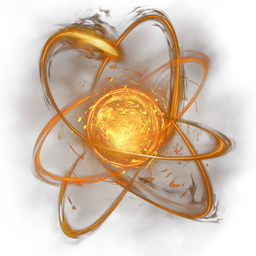

# Fog Goo 07 Archaic Essence VII

| | |
|---|---|
| Category | [Materials](../../categories/materials.md) |
| Rarity | ⚪ Common |
| Level | 45 |
| Max stack | 500 |
| Item ID | `2135602472` |
| Internal name | `Material_T7_Fognest_Ressource` |

## Description

A radiant whirl of energy that is needed to insert gems into weaponry. 

While initially used by the Ancients, it was claimed by the Fell to fuel their brood until you freed it from its newly organic prison.

## Where to find

Ancient Land Shroud, Shroud Lairs

## Used to make

[Ancient/Archaic Infusion](../../items/materials/ancient-archaic-infusion-2670118573.md)

---

[← Materials](../../categories/materials.md) · [All categories](../../README.md)
