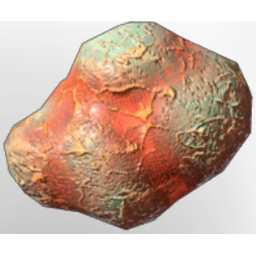

# Fog Sack

| | |
|---|---|
| Category | [Materials](../../categories/materials.md) |
| Rarity | ⚪ Common |
| Level | 13 |
| Max stack | 250 |
| Item ID | `1728169696` |
| Internal name | `Material_T2_Fog_Sack` |

## Description

An organic bag containing highly concentrated fog.

## Where to find

Fell Enemies, First: Revelwood Shroud

## Used to make

[Advanced Glider](../../items/tools/advanced-glider-1397467393.md), [Fog Arrow](../../items/ammunition/fog-arrow-3761680048.md), [Pheromone Shroud](../../items/weapons/pheromone-shroud-3145568607.md), [T2 DPS Legs](../../items/equipment/t2-dps-legs-3288350660.md), [T2 DPS Arms](../../items/equipment/t2-dps-arms-1108317357.md), [T2 Healer Arms](../../items/equipment/t2-healer-arms-614770460.md), [T2 Mage Arms](../../items/equipment/t2-mage-arms-475314263.md), [T2 Ranger Arms](../../items/equipment/t2-ranger-arms-1883961235.md), [T2 Archer Arms](../../items/equipment/t2-archer-arms-2683908044.md), [T2 Tank Arms](../../items/equipment/t2-tank-arms-1113469647.md)

---

[← Materials](../../categories/materials.md) · [All categories](../../README.md) · [JSON](fog-sack-1728169696.json)
