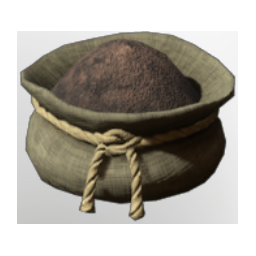

# Fossilized Bone Dust

| | |
|---|---|
| Category | [Materials](../../categories/materials.md) |
| Rarity | ⚪ Common |
| Level | 18 |
| Max stack | 250 |
| Item ID | `3073226096` |
| Internal name | `Material_T3_Fossilized_Bone_Dust` |

## Description

Grinding the Fossilized Bone into dust frees its inherent magical attributes and makes it more handy for further production steps.

## Where to find

Crafting, Hand Grinder

## How to get it

- **improved grinder; water wheel grinder)**: 1 × [Fossilized Bone](../../items/materials/fossilized-bone-3095665634.md) → 5 ×
- **Grinding Stones**: 1 × [Fossilized Bone](../../items/materials/fossilized-bone-3095665634.md) → 3 ×

## Used to make

[T3 Eternal Mana Leech Beam IV](../../items/ammunition/t3-eternal-mana-leech-beam-iv-2591238243.md), [Eternal Fire Arrow I](../../items/ammunition/eternal-fire-arrow-i-685713190.md), [T7 Eternal Chain Heal II](../../items/ammunition/t7-eternal-chain-heal-ii-1375984897.md), [T5 Chain Heal II](../../items/ammunition/t5-chain-heal-ii-3216582163.md), [T3 Eternal Ice Bolt II](../../items/ammunition/t3-eternal-ice-bolt-ii-521600917.md), [T3 Entangle II](../../items/ammunition/t3-entangle-ii-1100793430.md), [Chanterelle Seedling](../../items/buildtools/chanterelle-seedling-1783208373.md), [Wheat Seedling](../../items/buildtools/wheat-seedling-1811689543.md), [Rooibos Seedling](../../items/buildtools/rooibos-seedling-3764454676.md), [Pepper Seedling](../../items/buildtools/pepper-seedling-2330783516.md), [T4 Palette 03 maroon](../../items/colorpalette/t4-palette-03-maroon-3687407983.md), [T4 Palette 01 Brown yellow red](../../items/colorpalette/t4-palette-01-brown-yellow-red-3491275682.md), [T3 Palette 03 Brown Green Grey](../../items/colorpalette/t3-palette-03-brown-green-grey-2653935294.md), [T3 Palette 04 Brown Green Grey](../../items/colorpalette/t3-palette-04-brown-green-grey-2821660974.md), [T3 Palette 02 Brown Green Grey](../../items/colorpalette/t3-palette-02-brown-green-grey-2118938591.md), [Cryptic wand](../../items/weapons/cryptic-wand-4294860398.md), [Transcendental Screen](../../items/equipment/transcendental-screen-2821143924.md), [T3 DPS Chest](../../items/equipment/t3-dps-chest-3800404508.md), [T3 Ranger Chest](../../items/equipment/t3-ranger-chest-2255840984.md), [T3 Ranger Helmet](../../items/equipment/t3-ranger-helmet-977735658.md), [Ranger Fog Protection Armor](../../items/equipment/ranger-fog-protection-armor-13759280.md), [T3 Archer Chest](../../items/equipment/t3-archer-chest-2301277967.md), [T4 Assassin Boots](../../items/equipment/t4-assassin-boots-4024884903.md), [T4 BattleMage Arms](../../items/equipment/t4-battlemage-arms-3648209951.md), [T4 BattleMage Chest](../../items/equipment/t4-battlemage-chest-1331200386.md), [T4 BattleMage Helmet](../../items/equipment/t4-battlemage-helmet-1192801048.md), [T4 DPS Boots](../../items/equipment/t4-dps-boots-620048429.md), [T4 Healer Boots](../../items/equipment/t4-healer-boots-3615964892.md), [T4 Mage Arms](../../items/equipment/t4-mage-arms-398094556.md), [T4 Mage Chest](../../items/equipment/t4-mage-chest-1299163561.md), [T4 Ranger Boots](../../items/equipment/t4-ranger-boots-3486210573.md), [T4 DPS Arms](../../items/equipment/t4-dps-arms-706627686.md), [T4 sniper boots](../../items/equipment/t4-sniper-boots-345073573.md), [T4 Tank Boots](../../items/equipment/t4-tank-boots-1058485756.md), [Fertilised Farm Soil](../../items/materials/fertilised-farm-soil-260133819.md)

---

[← Materials](../../categories/materials.md) · [All categories](../../README.md)
