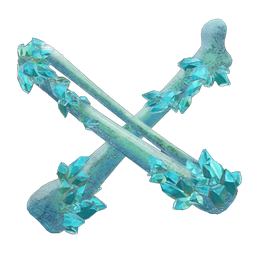

# Giant Ice Bones

| | |
|---|---|
| Category | [Materials](../../categories/materials.md) |
| Rarity | 🟢 Uncommon |
| Level | 33 |
| Max stack | 250 |
| Item ID | `3895216255` |
| Internal name | `Material_T5_Giant_Bones` |

## Description

These things are bone-chilling.

## Where to find

Enemies, Albaneve Summits Hollow Halls

## Used to make

[Wetland Hollow Halls Key](../../items/tools/wetland-hollow-halls-key-2543839394.md), [T7 Eternal Giant Bone Arrow II](../../items/ammunition/t7-eternal-giant-bone-arrow-ii-334395711.md), [T6 Eternal Giant Bone Arrow I](../../items/ammunition/t6-eternal-giant-bone-arrow-i-1610169156.md), [T6 Giant Bone Arrow IV](../../items/ammunition/t6-giant-bone-arrow-iv-3600953136.md), [T7 Eternal Bone Channel II](../../items/ammunition/t7-eternal-bone-channel-ii-297685721.md), [T6 Eternal Bone Channel I](../../items/ammunition/t6-eternal-bone-channel-i-1887970091.md), [T6 Bone Channel V](../../items/ammunition/t6-bone-channel-v-4054999373.md), [T7 Eternal Summon Skeleton II](../../items/ammunition/t7-eternal-summon-skeleton-ii-3370079249.md), [T6 Summon Skeleton II](../../items/ammunition/t6-summon-skeleton-ii-4252546627.md)

---

[← Materials](../../categories/materials.md) · [All categories](../../README.md)
