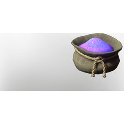

# Gleam Root Dust

| | |
|---|---|
| Category | [Materials](../../categories/materials.md) |
| Rarity | ⚪ Common |
| Level | 40 |
| Max stack | 250 |
| Item ID | `3507051762` |
| Internal name | `Material_T6_GleamRoot_Dust` |

## Description

t6 gleam root dust desc

## Where to find

Crafting, Improved Grinder

## How to get it

- **improved grinder; water wheel grinder)**: 1 × [Gleam Root](../../items/materials/gleam-root-2145533653.md) → 1 ×

## Used to make

[Eternal Shock Arrow II](../../items/ammunition/eternal-shock-arrow-ii-2453015274.md), [Veil Of Blues](../../items/colorpalette/veil-of-blues-391330740.md), [Frog In The Grass](../../items/colorpalette/frog-in-the-grass-3846605059.md), [Miner Helmet](../../items/equipment/miner-helmet-1392674456.md), [Gleam Root Diving Light](../../items/tools/gleam-root-diving-light-32289505.md)

---

[← Materials](../../categories/materials.md) · [All categories](../../README.md) · [JSON](gleam-root-dust-3507051762.json)
