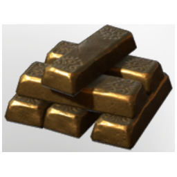

# Gold Bars

| | |
|---|---|
| Category | [Materials](../../categories/materials.md) |
| Rarity | ⚪ Common |
| Level | 40 |
| Max stack | 250 |
| Item ID | `514509650` |
| Internal name | `Material_T6_Gold_Bar` |

## Description

t6 Gold Bar desc

## Where to find

Blast Furnace

## How to get it

- **Blast Furnace**: 40 × T5 Material Coal Name, 20 × one of: [Gold Ore](../../items/materials/gold-ore-2715107589.md) / [Archaic Shards](../../items/materials/archaic-shards-2141541288.md) → 20 ×

## Used to make

[Wetland Hollow Halls Key](../../items/tools/wetland-hollow-halls-key-2543839394.md), [Enormous Magic Chest](../../items/buildtools/enormous-magic-chest-30818586.md), [Water Barrier Ground](../../items/buildtools/water-barrier-ground-1985606133.md), [Water Barrier Wall](../../items/buildtools/water-barrier-wall-3704426916.md), [T6 Lizard Temple Block](../../items/buildtools/t6-lizard-temple-block-755945588.md), [T6 Eternal Fireball II](../../items/ammunition/t6-eternal-fireball-ii-1334157650.md), [T6 Eternal Lightning Channel I](../../items/ammunition/t6-eternal-lightning-channel-i-1389638766.md), [T6 Shock Totem II](../../items/ammunition/t6-shock-totem-ii-3046388897.md), [Gold Dust](../../items/materials/gold-dust-1060230019.md), [T6 Tool Steel Axe](../../items/tools/t6-tool-steel-axe-246967425.md), [T6 Pickaxe Steel](../../items/buildtools/t6-pickaxe-steel-1268331874.md), [Fenrig's Axe](../../items/weapons/fenrig-s-axe-1735564804.md), [Jezmina's Apotheosis](../../items/weapons/jezmina-s-apotheosis-649877474.md), [Lupa's scalper](../../items/weapons/lupa-s-scalper-2432243778.md), [Dragonsbane](../../items/weapons/dragonsbane-2688480639.md), [Wolf's Hydra](../../items/weapons/wolf-s-hydra-2875621972.md), [Halescourge](../../items/weapons/halescourge-2409952376.md), [Wailing Blade](../../items/weapons/wailing-blade-105288636.md), [Greater Twinflame Sword](../../items/weapons/greater-twinflame-sword-3671319442.md), [Lesser Twinflame Sword](../../items/weapons/lesser-twinflame-sword-1786607643.md), [Dragon Sword](../../items/weapons/dragon-sword-2352034665.md), [Pikemead's Ward](../../items/equipment/pikemead-s-ward-3957855784.md), [Riptide](../../items/equipment/riptide-1474807415.md), [T6 Shield Tank](../../items/equipment/t6-shield-tank-1777113935.md), [T6 Shield DPS](../../items/equipment/t6-shield-dps-2863750697.md), [Golden Recruit Axe](../../items/weapons/golden-recruit-axe-500747971.md), [Ancestral Star](../../items/weapons/ancestral-star-430276931.md), [Golden War Veteran Axe](../../items/weapons/golden-war-veteran-axe-1877646424.md), [Soothsayer](../../items/weapons/soothsayer-2260780998.md), [Lord Vorgoth's Sword](../../items/weapons/lord-vorgoth-s-sword-4073230411.md), [Consumed fog soldier bow](../../items/weapons/consumed-fog-soldier-bow-852156015.md), [Draconian Bow](../../items/weapons/draconian-bow-3578254606.md), [Sacrificial Vukah Dagger](../../items/weapons/sacrificial-vukah-dagger-764137977.md), [Valor Heart Dagger](../../items/weapons/valor-heart-dagger-3096148752.md), [Throwing Knives](../../items/weapons/throwing-knives-3618171376.md), [T1 lore wand](../../items/weapons/t1-lore-wand-9995480.md), [Darya's Wand](../../items/weapons/darya-s-wand-1561187159.md), [Shroud Weaver](../../items/weapons/shroud-weaver-1621727293.md), [Darya's Staff](../../items/weapons/darya-s-staff-4287106432.md), [Ward T6](../../items/equipment/ward-t6-1467281560.md) and 110 more

---

[← Materials](../../categories/materials.md) · [All categories](../../README.md)
