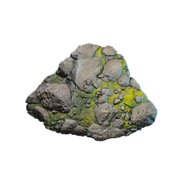

# Grassland Rubble

| | |
|---|---|
| Category | [Materials](../../categories/materials.md) |
| Rarity | ⚪ Common |
| Level | - |
| Max stack | 1000 |
| Item ID | `4233423640` |
| Internal name | `Build_TerrainMaterial_T1_Grassland_Rubble` |

## Description

mix of materials, mainly stones and dirt

## How to get it

- **Grinding Stones**: 1 × [Rubble](../../items/materials/rubble-1257792166.md), 4 × [Dirt](../../items/materials/dirt-1558115984.md), 5 × [Stone](../../items/materials/stone-631520303.md) → 10 ×

---

[← Materials](../../categories/materials.md) · [All categories](../../README.md)
