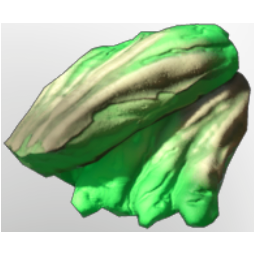

# Green Mushroom Meat

| | |
|---|---|
| Category | [Materials](../../categories/materials.md) |
| Rarity | ⚪ Common |
| Level | 18 |
| Max stack | 250 |
| Item ID | `90588998` |
| Internal name | `Material_T3_MushroomDrop_GreenMushroomMeat` |

## Description

Mushroom Meat that can be used to dye all sorts of fabrics in a green color.

## Where to find

find in Nomad Highlands Shroud

## Used to make

[Greater Fog Survival Flask](../../items/consumables/greater-fog-survival-flask-209497692.md), [Green Fabric](../../items/materials/green-fabric-2287874170.md), [Tbd T3 Palette 03 Reward](../../items/colorpalette/tbd-t3-palette-03-reward-1361344405.md), [T3 Palette 01 reward Green, green, green](../../items/colorpalette/t3-palette-01-reward-green-green-green-3841845306.md), [Tbd T3 Palette 02 Reward](../../items/colorpalette/tbd-t3-palette-02-reward-1017300382.md), [T3 Palette 02 Brown Green Grey](../../items/colorpalette/t3-palette-02-brown-green-grey-2118938591.md), [T3 Palette 01 Brown Green Grey](../../items/colorpalette/t3-palette-01-brown-green-grey-2717669072.md), [Shroud Nexus](../../items/materials/shroud-nexus-634473105.md), [T3 DPS Helmet](../../items/equipment/t3-dps-helmet-3255447356.md), [T3 Healer Legs](../../items/equipment/t3-healer-legs-823841299.md), [T3 Healer Arms](../../items/equipment/t3-healer-arms-4053860811.md), [T3 Mage Legs](../../items/equipment/t3-mage-legs-2743374359.md), [Mage Fog Protection Armor](../../items/equipment/mage-fog-protection-armor-4103714612.md), [T3 Ranger Helmet](../../items/equipment/t3-ranger-helmet-977735658.md), [Ranger Fog Protection Armor](../../items/equipment/ranger-fog-protection-armor-3038310088.md), [T3 Archer Legs](../../items/equipment/t3-archer-legs-3281783103.md), [T3 Tank Helmet](../../items/equipment/t3-tank-helmet-1221959339.md), [Warrior Fog Protection Armor](../../items/equipment/warrior-fog-protection-armor-2530259094.md), [Bed T3](../../items/buildtools/bed-t3-3415766653.md), [Iron Bench](../../items/buildtools/iron-bench-2616343052.md), [T4 Carpet](../../items/buildtools/t4-carpet-3319129258.md), [T3 Chair](../../items/buildtools/t3-chair-1461356575.md), [Table Large T3](../../items/buildtools/table-large-t3-2700082044.md), [Tabel Medium T3](../../items/buildtools/tabel-medium-t3-2992710503.md), [Table Small T3](../../items/buildtools/table-small-t3-2862710104.md), [Bedside T3](../../items/buildtools/bedside-t3-2959403836.md), [Wall Tapestry I](../../items/buildtools/wall-tapestry-i-500134615.md), [Wall Tapestry II](../../items/buildtools/wall-tapestry-ii-3696120404.md), [Wall Tapestry III](../../items/buildtools/wall-tapestry-iii-1201052636.md), [Wall Tapestry IV](../../items/buildtools/wall-tapestry-iv-1546063432.md), [Wall Tapestry V](../../items/buildtools/wall-tapestry-v-2303973776.md), ["Still Life"](../../items/buildtools/still-life-1237085664.md), ["Temple Landscape"](../../items/buildtools/temple-landscape-1790893349.md), ["Flower Snake"](../../items/buildtools/flower-snake-3753859139.md), ["Flightless Redtail On One Leg"](../../items/buildtools/flightless-redtail-on-one-leg-19079311.md), ["Tower In The Night"](../../items/buildtools/tower-in-the-night-3847020528.md), ["Flower Vase"](../../items/buildtools/flower-vase-1343085975.md), ["Boar At Home"](../../items/buildtools/boar-at-home-3201054228.md), ["Wolf's Choir"](../../items/buildtools/wolf-s-choir-1688806746.md), [Broken hollow Halls Banner](../../items/buildtools/broken-hollow-halls-banner-3639737989.md) and 8 more

---

[← Materials](../../categories/materials.md) · [All categories](../../README.md) · [JSON](green-mushroom-meat-90588998.json)
