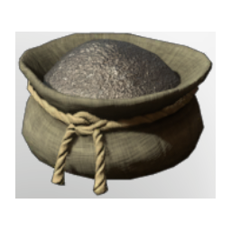

# Iron Dust

| | |
|---|---|
| Category | [Materials](../../categories/materials.md) |
| Rarity | ⚪ Common |
| Level | 40 |
| Max stack | 250 |
| Item ID | `4114143627` |
| Internal name | `Material_T6_Iron_Dust` |

## Description

t6 Iron dust desc

## Where to find

Crafting, Improved Grinder

## How to get it

- **improved grinder; water wheel grinder)**: 1 × [Iron Bars](../../items/materials/iron-bars-159114158.md) → 1 ×

## Used to make

[Stone Water Dispenser](../../items/buildtools/stone-water-dispenser-1310445763.md), [Eternal Shock Arrow II](../../items/ammunition/eternal-shock-arrow-ii-2453015274.md), [T6 Eternal Lightning Channel I](../../items/ammunition/t6-eternal-lightning-channel-i-1389638766.md), [T6 Shock Wisp III](../../items/ammunition/t6-shock-wisp-iii-396873784.md), [T6 Shock Totem II](../../items/ammunition/t6-shock-totem-ii-3046388897.md), [T6 Magic Shield](../../items/ammunition/t6-magic-shield-1713565263.md), [Exploding Arrow III](../../items/ammunition/exploding-arrow-iii-3342011345.md), [Green Vitriol Dust](../../items/materials/green-vitriol-dust-3702590848.md), [Cryptic wand](../../items/weapons/cryptic-wand-2053280664.md), [T1 lore wand](../../items/weapons/t1-lore-wand-9995480.md), [Darya's Wand](../../items/weapons/darya-s-wand-1561187159.md), [Vorgoth's Chest](../../items/equipment/vorgoth-s-chest-248650235.md), [Hang-Drum](../../items/buildtools/hang-drum-2038549065.md)

---

[← Materials](../../categories/materials.md) · [All categories](../../README.md) · [JSON](iron-dust-4114143627.json)
