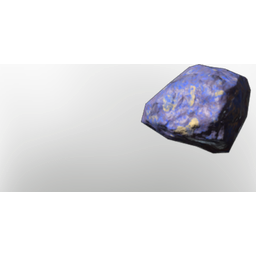

# Lapislazuli

| | |
|---|---|
| Category | [Materials](../../categories/materials.md) |
| Rarity | ⚪ Common |
| Level | 25 |
| Max stack | 250 |
| Item ID | `3044860358` |
| Internal name | `Material_T4_Lapislazuli` |

## Description

A rare gem famous for its magical properties as a catalyst. It's great for channeling and shielding!

## Where to find

Kindlewastes

## Used to make

[Moonshine and Stars Block](../../items/buildtools/moonshine-and-stars-block-688801496.md), [T4 Desert Shingles](../../items/buildtools/t4-desert-shingles-3899129081.md), [T4 Eternal Mana Leech Beam V](../../items/ammunition/t4-eternal-mana-leech-beam-v-289913176.md), [T4 Fire Bolt V](../../items/ammunition/t4-fire-bolt-v-2781335650.md), [T4 Pillar of Flames II](../../items/ammunition/t4-pillar-of-flames-ii-1805048399.md), [T3 Light Burst](../../items/ammunition/t3-light-burst-738997972.md), [T4 Eternal Heal Channel I](../../items/ammunition/t4-eternal-heal-channel-i-2337136795.md), [T4 Heal Beam Channel](../../items/ammunition/t4-heal-beam-channel-1087441899.md), [T4 Blizzard II](../../items/ammunition/t4-blizzard-ii-621614770.md), [T4 Eternal Ice Totem I](../../items/ammunition/t4-eternal-ice-totem-i-1138260679.md), [T4 Palette 04 yellow Grey](../../items/colorpalette/t4-palette-04-yellow-grey-3726799847.md), [Throwing Knives](../../items/weapons/throwing-knives-890590294.md), [Cryptic wand](../../items/weapons/cryptic-wand-4192516670.md), [Ethereal Plane](../../items/equipment/ethereal-plane-2418290854.md), [T4 Assassin Helmet](../../items/equipment/t4-assassin-helmet-1123774086.md), [T4 BattleMage Legs](../../items/equipment/t4-battlemage-legs-1563449197.md), [T4 BattleMage Arms](../../items/equipment/t4-battlemage-arms-3648209951.md), [T4 DPS Legs](../../items/equipment/t4-dps-legs-3072220773.md), [T4 Healer Boots](../../items/equipment/t4-healer-boots-3615964892.md), [T4 Healer Chest](../../items/equipment/t4-healer-chest-1947086683.md), [T4 Mage Arms](../../items/equipment/t4-mage-arms-398094556.md), [T4 Mage Helmet](../../items/equipment/t4-mage-helmet-3056375359.md), [T4 Ranger Helmet](../../items/equipment/t4-ranger-helmet-2666667832.md), [T4 Rogue Helmet](../../items/equipment/t4-rogue-helmet-107717902.md), [T4 Sniper Helmet](../../items/equipment/t4-sniper-helmet-3141427238.md), [T4 Tank Helmet](../../items/equipment/t4-tank-helmet-2870440263.md), [Iron Bench](../../items/buildtools/iron-bench-2616343052.md), [Sand Throne](../../items/buildtools/sand-throne-3587974368.md), [T5 Prop Decoration Comfort Table Magnificent](../../items/buildtools/t5-prop-decoration-comfort-table-magnificent-924954650.md), [Table T4 large](../../items/buildtools/table-t4-large-3011227787.md), [Table T4 Medium](../../items/buildtools/table-t4-medium-1434543946.md), [Blue Globe](../../items/buildtools/blue-globe-2977882835.md), [Ornamented Vase I](../../items/buildtools/ornamented-vase-i-1310569034.md), [Ornamented Vase II](../../items/buildtools/ornamented-vase-ii-155892145.md), [Ornamented Vase III](../../items/buildtools/ornamented-vase-iii-2822831184.md), [Ornamented Vase IV](../../items/buildtools/ornamented-vase-iv-3614671585.md), [Ornamented Vase V](../../items/buildtools/ornamented-vase-v-1881399211.md), [Ornamented Vase VI](../../items/buildtools/ornamented-vase-vi-1294494262.md), [T5 Prop Decoration Cupboard](../../items/buildtools/t5-prop-decoration-cupboard-4189323092.md), [T5 Prop Decoration Cupboard Small](../../items/buildtools/t5-prop-decoration-cupboard-small-49434563.md) and 2 more

---

[← Materials](../../categories/materials.md) · [All categories](../../README.md)
