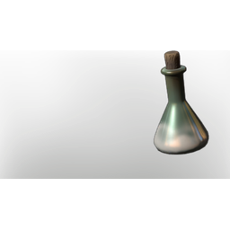

# Nitrate

| | |
|---|---|
| Category | [Materials](../../categories/materials.md) |
| Rarity | ⚪ Common |
| Level | 25 |
| Max stack | 250 |
| Item ID | `2206878080` |
| Internal name | `Material_T4_Nitrate` |

## Description

An alchemical acid used to create explosive substances.

## Where to find

Crafting, Laboratory

---

[← Materials](../../categories/materials.md) · [All categories](../../README.md)
