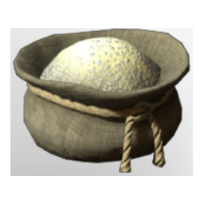

# Piscine Ivory Dust

| | |
|---|---|
| Category | [Materials](../../categories/materials.md) |
| Rarity | ⚪ Common |
| Level | 40 |
| Max stack | 250 |
| Item ID | `545888475` |
| Internal name | `Material_T6_Fish_Bone_Teeth_Dust` |

## Description

Piscine Ivory, often called the ivory of the sea, ground into a bright powder. Renowned for its strength and resilience, it can even serve as a component in metal alloys, lending them exceptional robustness.

## Where to find

Crafting, Improved Grinder

## How to get it

- **improved grinder; water wheel grinder)**: 1 × one of: [Fish Teeth](../../items/materials/fish-teeth-2352305513.md) / [Fish Bones](../../items/materials/fish-bones-2244383765.md) → 1 ×

## Used to make

[T6 Shield Tank](../../items/equipment/t6-shield-tank-1777113935.md), [T6 Shield DPS](../../items/equipment/t6-shield-dps-2863750697.md)

---

[← Materials](../../categories/materials.md) · [All categories](../../README.md) · [JSON](piscine-ivory-dust-545888475.json)
