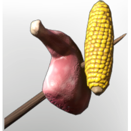

# Raw Meat and Corncob Skewer

| | |
|---|---|
| Category | [Materials](../../categories/materials.md) |
| Rarity | ⚪ Common |
| Level | 5 |
| Max stack | 250 |
| Item ID | `3975408930` |
| Internal name | `Material_T1_raw_dish_GrainSkewer` |

## Description

A hearty feast, that fortifies your body. Grilled over a Fire, this Skewer will increase your **melee damage, boost your maximum health and accelerate your health regeneration.**

## Where to find

Manual Crafting

## How to get it

- **an unnamed station**: 1 × [Corncob](../../items/consumables/corncob-3118804138.md), 1 × [Raw Lean Meat](../../items/consumables/raw-lean-meat-1492892444.md) → 1 ×

## Used to make

[Meat Skewer with Corncob](../../items/consumables/meat-skewer-with-corncob-2840500800.md)

---

[← Materials](../../categories/materials.md) · [All categories](../../README.md)
