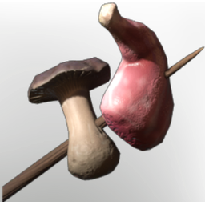

# Raw Meat and Mushroom Skewer

| | |
|---|---|
| Category | [Materials](../../categories/materials.md) |
| Rarity | ⚪ Common |
| Level | 5 |
| Max stack | 250 |
| Item ID | `2335785241` |
| Internal name | `Material_T1_raw_dish_MushroomSkewer` |

## Description

This mushroom skewer will not only strength your flesh, but ylso your mind. Grilled over a fire, it will raise your **maximum health, maximum mana and accelerates your mana regeneration.**

## Where to find

Manual Crafting

## How to get it

- **an unnamed station**: 1 × [Penny Bun](../../items/consumables/penny-bun-600862405.md), 1 × [Raw Lean Meat](../../items/consumables/raw-lean-meat-1492892444.md) → 1 ×

## Used to make

[Meat skewer with Mushroom](../../items/consumables/meat-skewer-with-mushroom-3286272712.md)

---

[← Materials](../../categories/materials.md) · [All categories](../../README.md) · [JSON](raw-meat-and-mushroom-skewer-2335785241.json)
