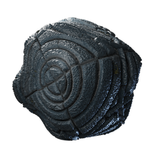

# Road Stone 5 Ancientland

| | |
|---|---|
| Category | [Materials](../../categories/materials.md) |
| Rarity | ⚪ Common |
| Level | - |
| Max stack | 250 |
| Item ID | `1187543406` |
| Internal name | `Build_TerrainMaterial_T7_Road_Stone_5` |

## Description

A road made from Ancient Land Stones

## How to get it

- **Workbench**: 7 × T7 material stone, 3 × [T7 AncientLand Rubble](../../items/materials/t7-ancientland-rubble-2780052662.md) → 10 ×

---

[← Materials](../../categories/materials.md) · [All categories](../../README.md) · [JSON](road-stone-5-ancientland-1187543406.json)
