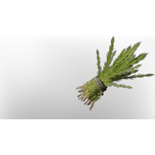

# Rooibos

| | |
|---|---|
| Category | [Materials](../../categories/materials.md) |
| Rarity | ⚪ Common |
| Level | 18 |
| Max stack | 250 |
| Item ID | `1628543982` |
| Internal name | `Material_T3_Rooibos` |

## Description

An interesting plant, stimulating every persons taste buds. The use in tea has established itself as a custom.

## Where to find

Nomad Highlands

## Used to make

[Rooibos Tea](../../items/consumables/rooibos-tea-2982995291.md), [Rooibos Seedling](../../items/buildtools/rooibos-seedling-3764454676.md), [Spice](../../items/materials/spice-1126086984.md), [T3 Healer Legs](../../items/equipment/t3-healer-legs-823841299.md), [T3 Healer Arms](../../items/equipment/t3-healer-arms-4053860811.md), [T3 Ranger Legs](../../items/equipment/t3-ranger-legs-1236068115.md), [Ranger Fog Protection Armor](../../items/equipment/ranger-fog-protection-armor-1184502832.md)

---

[← Materials](../../categories/materials.md) · [All categories](../../README.md)
