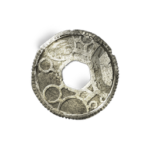

# Runes

| | |
|---|---|
| Category | [Materials](../../categories/materials.md) |
| Rarity | 🔵 Rare |
| Level | 5 |
| Max stack | 5000 |
| Item ID | `1101501148` |
| Internal name | `Material_T1_Token_WeaponUpgrade_Rune01` |

## Description

Used to upgrade Items

## Used to make

[Ancient Rune](../../items/materials/ancient-rune-2835143812.md)

---

[← Materials](../../categories/materials.md) · [All categories](../../README.md) · [JSON](runes-1101501148.json)
