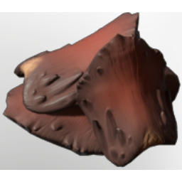

# Sanddigger Scales

| | |
|---|---|
| Category | [Materials](../../categories/materials.md) |
| Rarity | ⚪ Common |
| Level | 25 |
| Max stack | 250 |
| Item ID | `4079068070` |
| Internal name | `Material_T4_Scales` |

## Description

Hardened scales of the Sanddigger. Some say they are as hard as stone.

## Where to find

Kindlewastes

## Used to make

[Riptide](../../items/equipment/riptide-2644725310.md), [T4 Assassin Arms](../../items/equipment/t4-assassin-arms-853658470.md), [T4 Assassin Chest](../../items/equipment/t4-assassin-chest-2802395209.md), [T4 BattleMage Chest](../../items/equipment/t4-battlemage-chest-1331200386.md), [T4 DPS Arms](../../items/equipment/t4-dps-arms-1478658636.md), [T4 Healer Legs](../../items/equipment/t4-healer-legs-3183764632.md), [T4 Mage Boots](../../items/equipment/t4-mage-boots-1953528963.md), [T4 Ranger Arms](../../items/equipment/t4-ranger-arms-2309078212.md), [T4 Ranger Chest](../../items/equipment/t4-ranger-chest-960184859.md), [T4 Rogue Chest](../../items/equipment/t4-rogue-chest-1676245323.md), [T4 Sniper Legs](../../items/equipment/t4-sniper-legs-2035835813.md), [T4 Sniper Arms](../../items/equipment/t4-sniper-arms-3073964148.md), [T4 Sniper Chest](../../items/equipment/t4-sniper-chest-3452463502.md), [T4 Sniper Helmet](../../items/equipment/t4-sniper-helmet-3141427238.md), [T4 Tank Legs](../../items/equipment/t4-tank-legs-3856381953.md)

---

[← Materials](../../categories/materials.md) · [All categories](../../README.md) · [JSON](sanddigger-scales-4079068070.json)
