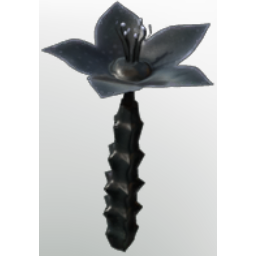

# Shadow Rose

| | |
|---|---|
| Category | [Materials](../../categories/materials.md) |
| Rarity | 🟢 Uncommon |
| Level | 33 |
| Max stack | 250 |
| Item ID | `310580024` |
| Internal name | `Material_T5_Night_Blackflower` |

## Description

shadow rose - used to produce dark black color

## Where to find

Albaneve Summits, night

## Used to make

[Nightplant tea](../../items/consumables/nightplant-tea-664951543.md), [Huge Mana Potion improved](../../items/consumables/huge-mana-potion-improved-3182673008.md), [T5 Eternal Mana Leech Beam VI](../../items/ammunition/t5-eternal-mana-leech-beam-vi-2971039479.md)

---

[← Materials](../../categories/materials.md) · [All categories](../../README.md)
