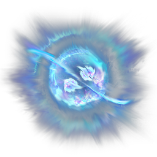

# Shroud Eminence

| | |
|---|---|
| Category | [Materials](../../categories/materials.md) |
| Rarity | 🟣 Epic |
| Level | 40 |
| Max stack | 250 |
| Item ID | `853884133` |
| Internal name | `Material_T6_Fog_Core03_ShroudEminence` |

## Description

The highest concentration of shroud energy, even higher than shroud nexus..

## Where to find

Crafting, Alchemist

## How to get it

- **Alchemist**: 10 × [Shroud Relic](../../items/materials/shroud-relic-3581489769.md), 5 × [Green Vitriol Dust](../../items/materials/green-vitriol-dust-3702590848.md), 10 × Placeholder: Pink Mushroom Meat → 1 ×

## Used to make

[Underwater Grappling Hook](../../items/tools/underwater-grappling-hook-3326121147.md), [Enormous Magic Chest](../../items/buildtools/enormous-magic-chest-30818586.md), [Pikemead's Ward](../../items/equipment/pikemead-s-ward-255353296.md)

---

[← Materials](../../categories/materials.md) · [All categories](../../README.md)
