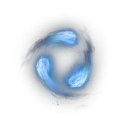

# Shroud Relic

| | |
|---|---|
| Category | [Materials](../../categories/materials.md) |
| Rarity | 🟢 Uncommon |
| Level | 40 |
| Max stack | 250 |
| Item ID | `3581489769` |
| Internal name | `Material_T6_Fog_Essence03_ShroudRelic` |

## Description

A higher concentration of shroud compared to shroud particles.

## Where to find

Fell Enemies, First: Veilwater Basin Shroud

---

[← Materials](../../categories/materials.md) · [All categories](../../README.md)
