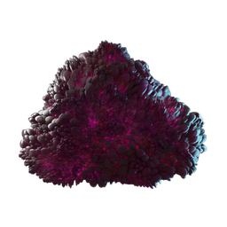

# Shroud Slime

| | |
|---|---|
| Category | [Materials](../../categories/materials.md) |
| Rarity | ⚪ Common |
| Level | 40 |
| Max stack | 250 |
| Item ID | `1803037496` |
| Internal name | `Material_T6_FogTerrain_ShroudSlime` |

## Description

soo slimy

## Where to find

Veilwater Basin Shroud

## Used to make

[Enormous Magic Chest](../../items/buildtools/enormous-magic-chest-30818586.md), [T6 Eternal Heal Beam Channel I](../../items/ammunition/t6-eternal-heal-beam-channel-i-1625866381.md), [Shroud Sludge](../../items/materials/shroud-sludge-1887186828.md)

---

[← Materials](../../categories/materials.md) · [All categories](../../README.md)
