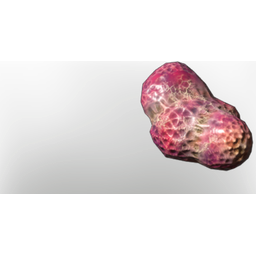

# Spider Gland

| | |
|---|---|
| Category | [Materials](../../categories/materials.md) |
| Rarity | ⚪ Common |
| Level | 5 |
| Max stack | 250 |
| Item ID | `1212327967` |
| Internal name | `Material_T1_SpiderGland` |

## Description

They are still dripping with poison

## Used to make

[Hemotoxication Antidode](../../items/consumables/hemotoxication-antidode-1410921691.md), [Antidote T2](../../items/consumables/antidote-t2-3441701492.md)

---

[← Materials](../../categories/materials.md) · [All categories](../../README.md)
