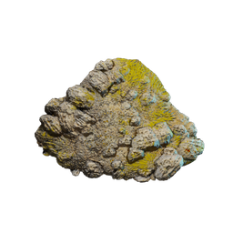

# Steppes Rubble

| | |
|---|---|
| Category | [Materials](../../categories/materials.md) |
| Rarity | ⚪ Common |
| Level | - |
| Max stack | 1000 |
| Item ID | `3232269711` |
| Internal name | `Build_TerrainMaterial_T3_Steppes_Rubble` |

## Description

mix of materials, mainly stones and dirt

## How to get it

- **Grinding Stones**: 1 × [Rubble](../../items/materials/rubble-1257792166.md), 4 × [Steppes Dirt](../../items/materials/steppes-dirt-2732808327.md), 5 × [Lime Stone](../../items/materials/lime-stone-3445636557.md) → 10 ×

---

[← Materials](../../categories/materials.md) · [All categories](../../README.md) · [JSON](steppes-rubble-3232269711.json)
