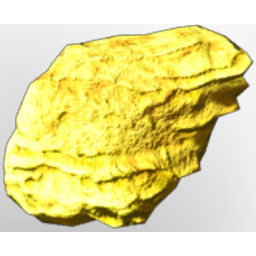

# Sulfur

| | |
|---|---|
| Category | [Materials](../../categories/materials.md) |
| Rarity | ⚪ Common |
| Level | 25 |
| Max stack | 250 |
| Item ID | `2819734894` |
| Internal name | `Material_T4_Sulfur` |

## Description

A really important material, as Sulfur is one of the basic chemical ingredients for nature.

## Where to find

Kindlewastes

## Used to make

[Ghost Glider](../../items/tools/ghost-glider-3357517884.md), [T4 Fire Bolt V](../../items/ammunition/t4-fire-bolt-v-2781335650.md), [Eternal Shock Arrow I](../../items/ammunition/eternal-shock-arrow-i-3133483038.md), [T4 Pillar of Flames II](../../items/ammunition/t4-pillar-of-flames-ii-1805048399.md), [T7 Eternal Light Burst II](../../items/ammunition/t7-eternal-light-burst-ii-377316946.md), [T4 Eternal Light Burst I](../../items/ammunition/t4-eternal-light-burst-i-72192472.md), [T3 Light Burst](../../items/ammunition/t3-light-burst-738997972.md), [T7 Eternal Heal Channel II](../../items/ammunition/t7-eternal-heal-channel-ii-61698870.md), [T4 Eternal Shock Wisp I](../../items/ammunition/t4-eternal-shock-wisp-i-1937493913.md), [T7 Eternal Acid Cone II](../../items/ammunition/t7-eternal-acid-cone-ii-1674086102.md), [T4 Eternal Acid Cone I](../../items/ammunition/t4-eternal-acid-cone-i-4291668892.md), [T7 Eternal Shroud Meteor](../../items/ammunition/t7-eternal-shroud-meteor-1835123088.md), [T4 Shroud Meteor](../../items/ammunition/t4-shroud-meteor-3940653429.md), [Poisoned Celesthium Steel Arrow](../../items/ammunition/poisoned-celesthium-steel-arrow-2685638060.md), [Poisoned Iron Arrow](../../items/ammunition/poisoned-iron-arrow-2369582730.md), [Skull Summoning Vessel](../../items/weapons/skull-summoning-vessel-1567174048.md), [Ginger In A Jungle](../../items/colorpalette/ginger-in-a-jungle-2434044399.md), [From Dusk Till Dawn](../../items/colorpalette/from-dusk-till-dawn-1860080518.md), [Waves Of Valor](../../items/colorpalette/waves-of-valor-1365809698.md), [Holly and Berry](../../items/colorpalette/holly-and-berry-1966532423.md), [Shades Of Red](../../items/colorpalette/shades-of-red-835723769.md), [Green Vitriol Dust](../../items/materials/green-vitriol-dust-3702590848.md), [T4 Palette 02 Brown yellow red](../../items/colorpalette/t4-palette-02-brown-yellow-red-2607932810.md), [Red Fabric](../../items/materials/red-fabric-3960097842.md), [Black Powder](../../items/materials/black-powder-1828629573.md), [Fog Oil](../../items/materials/fog-oil-1350606537.md), [Cryptic wand](../../items/weapons/cryptic-wand-4192516670.md), [T4 Mage Legs](../../items/equipment/t4-mage-legs-1616516574.md), [T4 Carpet](../../items/buildtools/t4-carpet-3319129258.md), [Wall Tapestry I](../../items/buildtools/wall-tapestry-i-500134615.md), [Wall Tapestry II](../../items/buildtools/wall-tapestry-ii-3696120404.md), [Wall Tapestry III](../../items/buildtools/wall-tapestry-iii-1201052636.md), [Wall Tapestry IV](../../items/buildtools/wall-tapestry-iv-1546063432.md), [Wall Tapestry V](../../items/buildtools/wall-tapestry-v-2303973776.md), ["Still Life"](../../items/buildtools/still-life-1237085664.md), ["Temple Landscape"](../../items/buildtools/temple-landscape-1790893349.md), ["Flower Snake"](../../items/buildtools/flower-snake-3753859139.md), ["Flightless Redtail On One Leg"](../../items/buildtools/flightless-redtail-on-one-leg-19079311.md), ["Tower In The Night"](../../items/buildtools/tower-in-the-night-3847020528.md), ["Flower Vase"](../../items/buildtools/flower-vase-1343085975.md) and 7 more

---

[← Materials](../../categories/materials.md) · [All categories](../../README.md)
