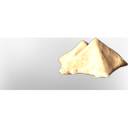

# T6 Wetlands Sand

| | |
|---|---|
| Category | [Materials](../../categories/materials.md) |
| Rarity | ⚪ Common |
| Level | - |
| Max stack | 1000 |
| Item ID | `2181045178` |
| Internal name | `Build_TerrainMaterial_T6_Dirt_Wetlands_Sand` |

## Description

A bright Sand from shells

## Where to find

Veilwater Basin

## Used to make

[Ground Coffee Beans](../../items/materials/ground-coffee-beans-1358181917.md), [Fertile Wetlands T6 Dirt](../../items/materials/fertile-wetlands-t6-dirt-1422307195.md)

---

[← Materials](../../categories/materials.md) · [All categories](../../README.md)
