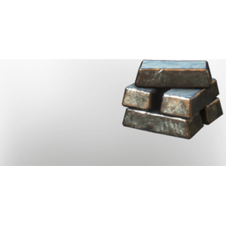

# Tin Bars

| | |
|---|---|
| Category | [Materials](../../categories/materials.md) |
| Rarity | ⚪ Common |
| Level | 18 |
| Max stack | 250 |
| Item ID | `1072522988` |
| Internal name | `Material_T3_Tin_Bars` |

## Description

A metal used to create bronze which can be found in the steppes.

## Where to find

Smelter

---

[← Materials](../../categories/materials.md) · [All categories](../../README.md)
